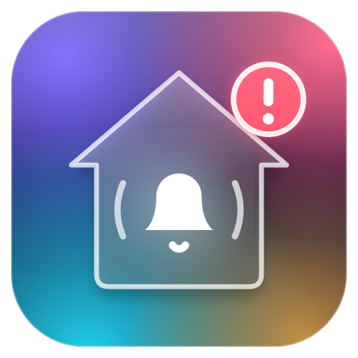
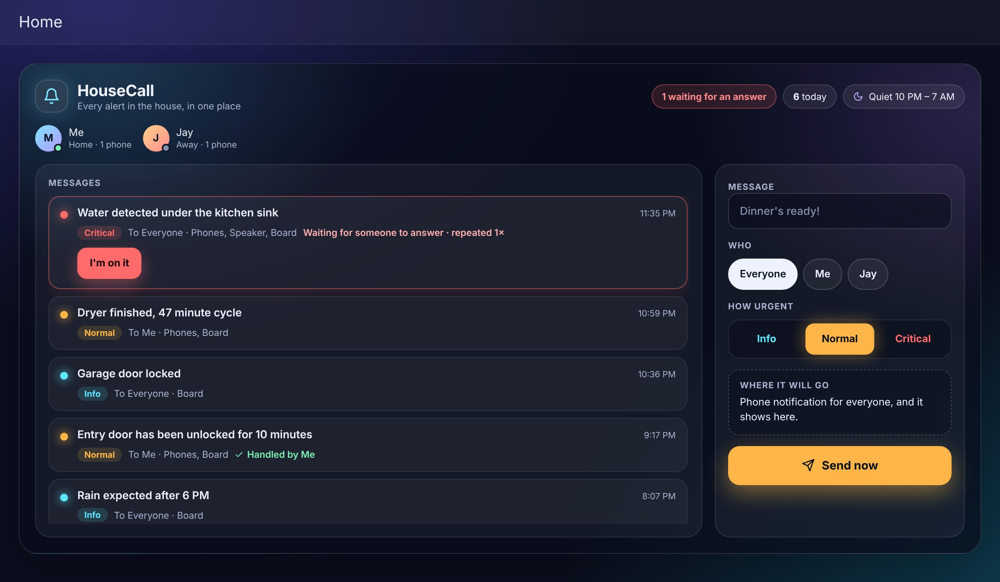
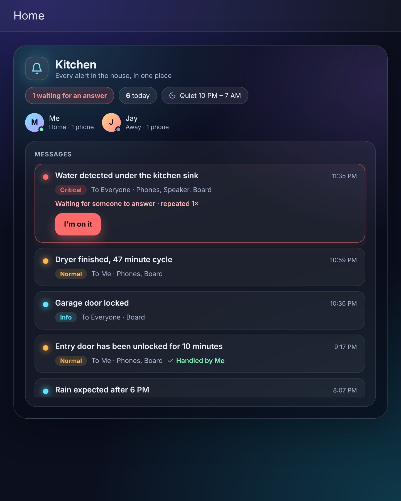

<div align="center">



# HouseCall

**Every alert in the house, in one place.**

[](https://hacs.xyz/docs/faq/custom_repositories)
[](https://www.home-assistant.io/)
[](CHANGELOG.md)
[](LICENSE)

</div>

Beautiful design and ease of use. https://github.com/Degederon/HouseCall

HouseCall makes sending alerts in Home Assistant simple:

- You send a message to **people** (*Me*, *Jay*, *Everyone*), not to phones or devices.
- You choose how urgent it is: **Info**, **Normal** or **Critical**.
- HouseCall does the rest. It picks the right phones, waits during quiet hours, reads critical alerts aloud, and keeps ringing until someone taps **I'm on it**.

It matches the look of [Glass Message Board](https://github.com/Degederon/GlassMessageBoard) and [Grand Marquee](https://github.com/Degederon/grand-marquee), and posts its messages to your Glass Message Board too.

## Contents

1. [What HouseCall does](#what-housecall-does)
2. [Take a tour](#take-a-tour)
3. [The three levels of urgency](#the-three-levels-of-urgency)
4. [Before you start](#before-you-start)
5. [Set up HouseCall](#set-up-housecall) (5 steps)
6. [Everyday use](#everyday-use)
7. [Change settings](#change-settings)
8. [Reach people who don't use the Home Assistant app](#reach-people-who-dont-use-the-home-assistant-app) (optional)
   - [Messaging services: Telegram, ntfy, email, WhatsApp, Messenger, Discord/Slack](#messaging-services)
9. [Send a test message](#send-a-test-message)
10. [Use HouseCall in automations](#use-housecall-in-automations)
11. [Card options](#card-options)
12. [Troubleshooting](#troubleshooting)

## What HouseCall does

| Feature | What it means for you |
|---|---|
| **People, not devices** | Send to *Me*, *Jay* or *Everyone*. HouseCall finds each person's phone by itself. |
| **Three levels of urgency** | Quiet notes, ordinary messages, or loud alarms. See [below](#the-three-levels-of-urgency). |
| **Quiet hours** | Ordinary messages wait until morning. Alarms always get through. |
| **"I'm on it"** | One tap stops the alarm on everyone's phone and tells the others who's handling it. |
| **Speakers** | Alarms are read aloud on the speakers you choose. |
| **Glass Message Board** | Every message also appears as a note on your board. |
| **Messaging services** | Optionally reach people on Telegram, ntfy, email, WhatsApp, Messenger or a Discord/Slack channel. Built in and free, nothing else to install. |
| **Send a test message** | Check that someone can be reached, without a real alarm. |
| **Frosted-glass card** | Today's messages, who's home, and a message box, all in one card. |
| **No YAML** | Everything is set up from the Home Assistant screens. |

## Take a tour

All pictures show the HouseCall card on a Home Assistant dashboard with example messages.

<table>
<tr>
<td width="50%" valign="top"><br><sub>The full card on a wall tablet: today's messages, who's home, and the message box. A critical leak alert is waiting for an answer.</sub></td>
<td width="50%" valign="top"><br><sub>Sending a critical alert to Jay. The card explains exactly what will happen before you press Send.</sub></td>
</tr>
<tr>
<td width="50%" valign="top"><br><sub>An Info message only shows on the board. Nobody's phone buzzes.</sub></td>
<td width="50%" valign="top"><br><sub>After someone taps <b>I'm on it</b>, the alarm stops and the alert is marked as handled.</sub></td>
</tr>
<tr>
<td width="50%" valign="top"><br><sub>Messages only, without the message box, here as a kitchen display.</sub></td>
<td width="50%" valign="top"><br><sub>On a phone, the message box moves below the messages.</sub></td>
</tr>
</table>

## The three levels of urgency

Every message has one of three levels. This is the only choice you make when you send something.

| Level | Use it for | What happens |
|---|---|---|
| **Info** | Things nice to know: *"Dogs fed"*, *"Rain tonight"* | Shows on the card and board only. **No phone buzzes.** |
| **Normal** | Everyday messages: *"Dinner's ready"*, *"Dryer finished"* | A normal phone notification, plus the board. **During quiet hours it waits until morning.** |
| **Critical** | Emergencies: *"Water leak"*, *"Smoke alarm"* | **Loud on phones, even on silent.** Read aloud on speakers. **Repeats every 5 minutes until someone taps "I'm on it".** |

When someone taps **I'm on it**:

1. The alarm stops on everyone's phone.
2. Everyone else gets a short note: *"Jay is handling it: Water leak"*.
3. The card shows **Handled by Jay**.

If nobody answers, HouseCall stops after 6 repeats and marks the alert **Nobody answered**.

## Before you start

You need:

- **Home Assistant 2024.11 or later.**
- **A "person" for each family member** in Home Assistant (**Settings → People**).
- **The Home Assistant app** on each phone, signed in. This is how phones get alerts.
- **On iPhone:** allow **Critical Alerts** for the Home Assistant app (iPhone **Settings → Notifications → Home Assistant**), so alarms can sound on silent.

Optional extras: speakers for read-aloud alarms, [Glass Message Board](https://github.com/Degederon/GlassMessageBoard), and messaging services for people without the Home Assistant app.

## Set up HouseCall

Do these five steps once, in order.

### Step 1: Install HouseCall

**Home Assistant 2026.11 and later (Marketplace)**

1. Go to **Settings → Marketplace**.
2. Choose **Add via link** and paste `https://github.com/Degederon/HouseCall`.
3. Open **HouseCall** and select **Install**.
4. Restart Home Assistant: **Settings → System → ⏻ (top right) → Restart Home Assistant**.

**Earlier versions (HACS)**

1. In HACS, open **⋮ → Custom repositories**.
2. Paste `https://github.com/Degederon/HouseCall`, choose **Integration**, and select **Add**.
3. Search for **HouseCall**, install it, and restart Home Assistant.

### Step 2: Add HouseCall to Home Assistant

1. Go to **Settings → Devices & services**.
2. Select **+ Add integration** and search for **HouseCall**.
3. HouseCall shows the people and phones it found. Select **Submit**.

### Step 3: Add the HouseCall card to a dashboard

1. Open a dashboard and select the pencil (top right) to edit it.
2. Select **+ Add card**, search for **HouseCall**, and select it.
3. Select **Save**.

> [!TIP]
> Prefer a ready-made page? Use the [starter dashboard](#optional-use-the-starter-dashboard) instead.

### Step 4: Send your first message

1. In the card, type *Dinner's ready!*
2. Choose **Everyone** and **Normal**.
3. Read **Where it will go**, then select **Send now**. Your phone buzzes.

### Step 5: Try an alarm

1. Type *Test*, choose **only yourself**, and choose **Critical**.
2. Select **Send now**. Your phone rings loudly, even on silent.
3. Stop it by tapping **I'm on it**, either on the card or on the notification ([how to find it](#answering-an-alarm)).

That's it. HouseCall is set up.

### Optional: use the starter dashboard

The [starter dashboard](examples/starter-dashboard.yaml) is a ready-made page with:

- the HouseCall card,
- one-tap buttons such as *Dinner's ready*, *Leaving now* and *Good night*,
- how many alarms are waiting, and test buttons,
- a second page for a kitchen display.

To add it:

1. Go to **Settings → Dashboards → + Add dashboard → New dashboard from scratch**. Name it **HouseCall** and open it.
2. Select the pencil, then **⋮ → Raw configuration editor**.
3. Delete everything there, paste the [starter dashboard](examples/starter-dashboard.yaml), and select **Save**.

If you name it **HouseCall**, tapping a HouseCall notification opens this page automatically.

## Everyday use

### Sending a message

In the card: type the message, choose **Who** and **How urgent**, check **Where it will go**, and select **Send now**.

### Answering an alarm

You can tap **I'm on it** in two places:

- **On the card:** the alert has a red border and an **I'm on it** button.
- **On your phone:** the button is on the notification, but hidden at first.
  - **iPhone:** press and hold the notification.
  - **Android:** swipe down on the notification.
  - A plain tap opens your HouseCall dashboard, where the button is on the card.

## Change settings

All settings are in one place: **Settings → Devices & services → HouseCall → Configure**.

| Menu item | What you can change |
|---|---|
| **People from Home Assistant: show or hide** | Who appears in HouseCall, and their phones. |
| **Add a HouseCall-only person** | Add someone who isn't in Home Assistant, such as Grandma. |
| **Change or remove a HouseCall-only person** | Edit or delete them. |
| **Messaging services** | Telegram, ntfy, email, WhatsApp, Messenger, Discord/Slack. [Details](#messaging-services). |
| **Send a test message** | Check how someone can be reached. [Details](#send-a-test-message). |
| **Quiet hours** | When Normal messages wait. Default: 10 PM to 7 AM. |
| **Phones, speakers, Glass Message Board and repeats** | Which page opens when a notification is tapped, speakers and voice for alarms, posting to Glass Message Board, and how often alarms repeat. |

### People

HouseCall uses the people in **Settings → People**. You can also hide some, or add your own.

**Hide someone** (for example a guest or service account you can't delete):

1. **Configure → People from Home Assistant: show or hide**.
2. Untick them and select **Submit**. They stay in Home Assistant but disappear from HouseCall.

**Add someone who isn't in Home Assistant** (such as Grandma or a babysitter):

1. **Configure → Add a HouseCall-only person**.
2. Type their name. If they have the Home Assistant app, pick their phone.
3. Optionally, pick something that shows whether they're home.
4. Select **Submit**. In automations, send to them by name: `to: Grandma`.

**Add a new family member from Home Assistant:**

1. Add them under **Settings → People**, and under **Track device** pick their phone.
2. **Configure → People from Home Assistant: show or hide**, tick them, and select **Submit**.

### Speakers and Glass Message Board

Under **Configure → Phones, speakers, Glass Message Board and repeats**:

- **Speakers and voice:** pick both, and alarms are read aloud.
- **Glass Message Board:** on by default if it's installed. Notes are tinted blue (Info), amber (Normal) or rose (Critical), and alarms are pinned.
- **Repeats:** how often alarms repeat (default every 5 minutes) and when to give up (default after 6 times).
- **Dashboard to open:** the page that opens when someone taps a notification.

## Reach people who don't use the Home Assistant app

**This part is optional.** Everyone with the Home Assistant app already gets everything.

For people who won't install the Home Assistant app, you have two free choices:

1. **Give them a login to your Home Assistant.** Add them under **Settings → People** with **Allow login** on, and have them install the Home Assistant app. They then get everything, including loud alarms. Their app must be able to reach your Home Assistant from outside your house.
2. **Use a messaging service they already have.** HouseCall has free messaging services built in, with nothing else to install. See below.

> [!NOTE]
> Messages in Telegram, ntfy, email and so on can't sound an alarm on silent. Only the Home Assistant app can.

## Messaging services

HouseCall has these services built in. All of them are free. You only switch on the ones you want, and anything you don't tick is ignored.

| Service | Good for | What each person needs |
|---|---|---|
| **Telegram** ⭐ recommended | Everyone. Alarms come with an **I'm on it** button right in the chat. | The free Telegram app. |
| **ntfy** | People who want a simple alerts app with no account. | The free ntfy app. |
| **Email** | Anyone with an email address. | Nothing. |
| **WhatsApp** | People who only use WhatsApp. | WhatsApp, plus a free personal key from CallMeBot (one message, once). |
| **Facebook Messenger** | People who only use Messenger. | Messenger, plus a free personal key from CallMeBot (one message, once). |
| **Discord or Slack channel** | A family group chat. | To be in the channel. |

WhatsApp and Messenger go through **CallMeBot**, a free outside service for personal use. WhatsApp and Facebook offer no free official way, so it may sometimes be slow or unavailable. Use it as an extra, not your only way to reach someone.

### Switch services on: 3 steps

1. Go to **Settings → Devices & services → HouseCall → Configure → Messaging services**.
2. **Tick the services you want**, choose [when to use them](#when-messaging-services-are-used), and select **Submit**.
3. HouseCall now shows **one setup page for each new service**, with numbered steps and a help link. It checks each one works before saving. The guides are below.

### Tell HouseCall how to reach each person

1. **Configure → Messaging services**. Leave the ticks as they are.
2. Under **Then set up messaging for**, pick a person and select **Submit**.
3. Fill in only what that person uses: their Telegram chat, ntfy, email address, WhatsApp or Messenger key, or the family channel. Select **Submit**.
4. Check it with [Send a test message](#send-a-test-message), choosing **Messaging apps only**.

### When messaging services are used

| Choice | What happens |
|---|---|
| **Recommended** | Alarms go to everyone's messaging services. People without the Home Assistant app also get every Normal message there. |
| **Every Normal and Critical message** | Everyone gets everything in their messaging services too. |
| **Only for people without the Home Assistant app** | Messaging is only used for those people. |
| **Never** | Messaging is switched off. |

Info messages and alarm repeats never go to messaging services, so chats don't get flooded.

### Telegram

**Once, for the house (2 minutes):**

1. In Telegram, search for **@BotFather** and open it.
2. Send **/newbot**.
3. Type a name, such as *Our House*, then a username that ends in *bot*, such as *OurHouseCallBot*.
4. BotFather replies with a **token**, a long code like `123456:ABC-DEF…`. Copy it.
5. Paste it on HouseCall's **Set up Telegram** page and select **Submit**. HouseCall checks the token.

Use a new bot just for HouseCall. If Home Assistant's own Telegram bot integration uses the same bot, the **I'm on it** button won't work.

**For each person:**

1. They open your bot in Telegram (search for its username) and tap **Start**.
2. In HouseCall, set up messaging for that person. Their name now appears in the **Telegram chat** list. Pick it and select **Submit**.

If their name isn't in the list yet, close the settings window, wait a few seconds, and open it again.

Alarms arrive with an **I'm on it** button. Tapping it works just like the button in the Home Assistant app.

### ntfy

**Once, for the house:** tick **ntfy** and keep the server as `https://ntfy.sh`. There's no account to create.

**For each person:**

1. In HouseCall, set up messaging for that person and switch on **Use ntfy**.
2. The next page shows their private **topic**, such as `housecall-jay-3f9a1c2b`.
3. On their phone, they install the free **ntfy** app, tap **+**, and type that topic exactly.

Keep the topic private: anyone who knows it can read the messages. Alarms arrive with ntfy's highest priority.

### Email

**Once, for the house:**

1. Pick your email provider: **Gmail**, **Yahoo Mail**, **iCloud Mail**, or **Other**.
2. Type the email address to send from.
3. Type an **app password** for that account (not your normal password):
   - **Gmail:** Google Account → **Security** → turn on **2-Step Verification** → **App passwords** → create one called *HouseCall*.
   - **Yahoo:** Account Info → **Account security** → **Generate app password**.
   - **iCloud:** appleid.apple.com → **Sign-In and Security** → **App-Specific Passwords**.
4. For **Other**, also fill in the server, port and security from your provider's help pages.
5. Select **Submit**. HouseCall signs in to check it works, without sending anything.

**For each person:** type their email address. Separate several with commas.

### WhatsApp

WhatsApp uses the free CallMeBot service. **Each person** gets their own key once:

1. On **their** phone, go to [callmebot.com's WhatsApp page](https://www.callmebot.com/blog/free-api-whatsapp-messages/) and follow its steps. They add CallMeBot's number to their contacts and send it the activation message shown there.
2. CallMeBot replies with their **API key**.
3. In HouseCall, set up messaging for that person. Type their WhatsApp number with country code (`+15551234567`) and the key.

### Facebook Messenger

Messenger also uses the free CallMeBot service. **Each person** gets their own key once:

1. On **their** phone, go to [callmebot.com's Messenger page](https://www.callmebot.com/blog/facebook-messenger-free-api-home-assistant/) and follow its steps to send the activation message to CallMeBot in Messenger.
2. CallMeBot replies with their **API key**.
3. In HouseCall, set up messaging for that person and type the key.

### Discord or Slack channel

**Once, for the house:**

- **Discord:** open the channel's settings (⚙) → **Integrations** → **Webhooks** → **New Webhook** → **Copy Webhook URL**.
- **Slack:** add an **Incoming Webhook** for the channel and copy its URL.

Paste the link on HouseCall's setup page. HouseCall posts a short hello in the channel to check it works.

**For each person:** switch on **Also post their messages in the family channel**. Each message is posted once, however many people it's for.

### Other apps already in Home Assistant (advanced)

If you already use another messaging integration in Home Assistant, such as **Signal Messenger**, HouseCall can send through it too. It appears under **Other apps already in Home Assistant** on each person's page. For apps that need it, HouseCall asks for their number, email address or channel. Apple iMessage, Google Messages and Instagram can't be used.

## Send a test message

Check that someone can be reached, without sending a real alarm:

1. **Configure → Send a test message**.
2. Pick the person and how to send: **Everything they have**, **Home Assistant app only**, or **Messaging apps only**.
3. Select **Submit**. You'll see a ✅ or ❌ for each way HouseCall tried, with the reason if something failed.

Test messages aren't saved in the message history. The starter dashboard also has a **Test messaging apps** button.

## Use HouseCall in automations

In the automation editor, add the action **HouseCall: Send**. You only need three things: the message, who it's for, and how urgent it is.

```yaml
- action: housecall.send
  data:
    message: Water under the kitchen sink!
    to: everyone          # or a name: Jay, Grandma, or a list
    priority: critical    # info | normal | critical
```

### Examples

**Water leak: wake everyone**

```yaml
alias: Water leak
triggers:
  - trigger: state
    entity_id: binary_sensor.kitchen_leak
    to: "on"
actions:
  - action: housecall.send
    data:
      message: Water under the kitchen sink!
      priority: critical
```

**Laundry done: just me**

```yaml
alias: Dryer finished
triggers:
  - trigger: state
    entity_id: sensor.dryer_status
    to: complete
actions:
  - action: housecall.send
    data:
      message: Dryer finished
      to: Me
```

**Door left unlocked**

```yaml
alias: Entry door left unlocked
triggers:
  - trigger: state
    entity_id: lock.entry_door
    to: unlocked
    for: "00:10:00"
actions:
  - action: housecall.send
    data:
      message: The entry door has been unlocked for 10 minutes
      to: everyone
```

**Quiet board note**

```yaml
alias: Rain tonight
triggers:
  - trigger: time
    at: "16:00:00"
conditions:
  - condition: numeric_state
    entity_id: sensor.precipitation_probability
    above: 60
actions:
  - action: housecall.send
    data:
      message: Rain expected this evening
      priority: info
```

**Turn on the lights when an alarm is handled**

```yaml
alias: Leak handled
triggers:
  - trigger: event
    event_type: housecall_acknowledged
actions:
  - action: light.turn_on
    target:
      entity_id: light.kitchen
```

### All actions

| Action | What it does | Fields |
|---|---|---|
| `housecall.send` | Sends a message. | `message` (required), `to`, `priority`, `title` |
| `housecall.acknowledge` | Marks an alarm as handled and stops it. | `id` (required), `by` |
| `housecall.send_test` | Sends a test to one person and reports what worked. | `to` (required), `how`: `all`, `app` or `messaging` |
| `housecall.clear_history` | Removes every message. | none |

### Entity and events

| Name | What it is |
|---|---|
| `sensor.housecall` | How many alarms are waiting for an answer. |
| Event `housecall_acknowledged` | Fired when someone taps **I'm on it** (`id`, `by`). |
| Event `housecall_updated` | Fired whenever a message is sent, held, repeated or handled. |

## Card options

The card works with no settings. To change it, open the card's **⋮** menu and choose **Edit in YAML**.

```yaml
type: custom:housecall-card
title: Kitchen            # name at the top (default: HouseCall)
show_composer: false      # hide the message box, for a display-only screen
max_items: 20             # how many messages to show
```

## Troubleshooting

| Problem | What to do |
|---|---|
| A red **Configuration error** box instead of the card | Check **HouseCall** is listed under **Settings → Devices & services** (if not, do [Step 2](#step-2-add-housecall-to-home-assistant)). Then restart Home Assistant and hard-refresh the browser (**Ctrl + Shift + R**, or **Reset frontend cache** in the phone app). |
| The card looks old after an update | Restart Home Assistant and hard-refresh the browser. |
| A person shows **0 phones** | Pick their phone under **Configure → People from Home Assistant: show or hide**, or under **Settings → People → Track device**. |
| Alarms aren't loud on iPhone | Allow **Critical Alerts** for the Home Assistant app in iPhone **Settings → Notifications → Home Assistant**. |
| Alarms aren't loud on Android | In the Home Assistant app: **Settings → Companion app → Notification channels → alarm_stream**, and allow sound. |
| I can't find **I'm on it** on my phone | Press and hold the notification (iPhone) or swipe down on it (Android). |
| **I'm on it** on the card does nothing | Update HouseCall, restart Home Assistant, and hard-refresh the browser. |
| Tapping a notification opens the wrong page | Choose the page under **Configure → Phones, speakers, Glass Message Board and repeats**. |
| A Normal message didn't reach my phone | It's quiet hours. It shows on the board now and reaches phones in the morning. |
| Speakers don't read alarms | Pick both a speaker and a voice under **Configure → Phones, speakers, Glass Message Board and repeats**. |
| Nothing appears on Glass Message Board | Check Glass Message Board is installed, and that posting to it is on under **Configure**. |
| A Telegram person isn't in the list | They need to open your bot and tap **Start** first. Then close the settings window and open it again. |
| The Telegram **I'm on it** button does nothing | Another program uses the same bot. Make a new bot just for HouseCall and paste its token under **Configure → Messaging services**. |
| Email says the password was refused | Use an **app password**, not your normal password. See [Email](#email). |
| WhatsApp or Messenger messages don't arrive | Check the person's key and number, and that they activated CallMeBot from their own phone. CallMeBot is a free outside service and is sometimes slow. |
| A test shows ❌ for a messaging service | Read the reason next to it. It explains what to fix in plain words. |
| An alarm says **Nobody answered** | Nobody tapped **I'm on it** before the last repeat, or Home Assistant restarted. |

Still stuck? Go to **Settings → System → Logs**, search for `housecall`, and include what you find when you [report a problem](https://github.com/Degederon/HouseCall/issues).

## Contributing

Bug reports and pull requests are welcome. When reporting a problem, please include your Home Assistant version, your phone type, and any relevant entries from the Home Assistant log.

## License

Released under the [MIT License](LICENSE).
