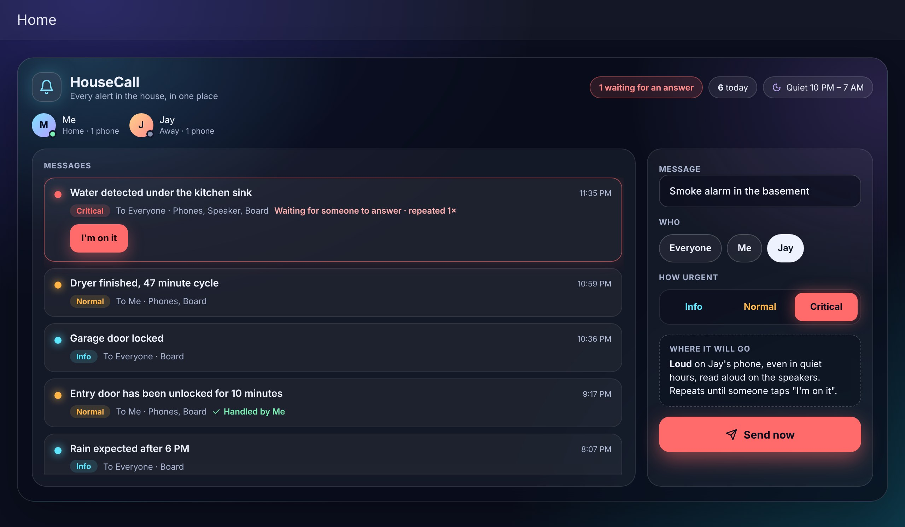
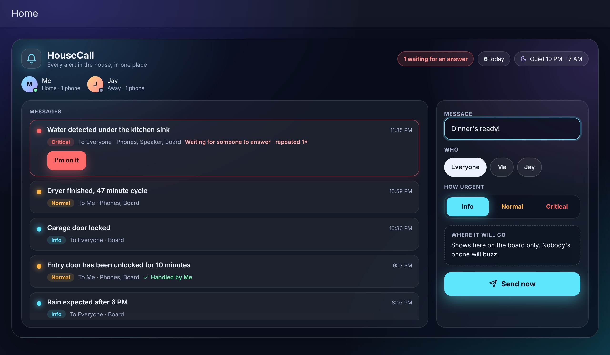
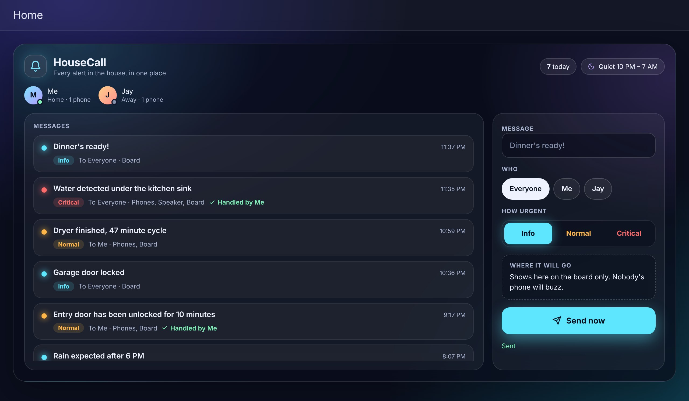
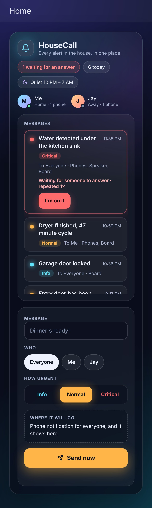

<div align="center">


# HouseCall

**Every alert in the house, in one place.**

[](https://hacs.xyz/docs/faq/custom_repositories)
[](https://www.home-assistant.io/)
[](CHANGELOG.md)
[](LICENSE)

</div>

Beautiful design and ease of use. https://github.com/Degederon/HouseCall

HouseCall makes notifications in Home Assistant simple. You send a message to **people** (Me, Jay, Everyone) instead of to device names, and pick how urgent it is: **Info**, **Normal** or **Critical**. HouseCall works out the rest. It chooses the right phones, holds messages during quiet hours, reads critical alerts aloud on your speakers, and keeps repeating them until someone taps **I'm on it**. It matches the look of [Glass Message Board](https://github.com/Degederon/GlassMessageBoard) and [Grand Marquee](https://github.com/Degederon/grand-marquee), and posts its messages to your Glass Message Board too.

## Contents

- [Features](#features)
- [Take a tour](#take-a-tour)
- [Requirements](#requirements)
- [Step-by-step setup](#step-by-step-setup)
  - [Adding and removing people](#adding-and-removing-people)
  - [Starter dashboard](#part-6-start-from-the-sample-dashboard-optional)
- [Dashboard configuration](#dashboard-configuration)
- [How urgency works](#how-urgency-works)
- [Actions](#actions)
- [Entities and events](#entities-and-events)
- [Automation examples](#automation-examples)
- [Troubleshooting](#troubleshooting)
- [Contributing](#contributing)
- [License](#license)

## Features

| Feature | Description |
|---|---|
| **People, not devices** | Send to *Me*, *Jay* or *Everyone*. HouseCall finds each person's phone from the Companion app automatically. Hide accounts you don't want, or add HouseCall-only people such as Grandma. |
| **Three levels of urgency** | **Info** shows on the board only. **Normal** goes to phones and the board. **Critical** is loud, breaks through silent mode, and repeats until someone answers. |
| **Quiet hours** | Normal messages wait until morning and still show on the board. Critical alerts always come through. |
| **"I'm on it"** | One tap on a phone or the card stops the repeats, clears the alert from everyone's phone, and tells the others who's handling it. |
| **Speakers** | Critical alerts are read aloud on the speakers you choose. |
| **Glass Message Board** | Every message also appears as a note on your board, tinted by urgency (blue, amber, rose). Critical notes are pinned. The board doesn't send a second phone notification. |
| **Where it will go** | Before you press Send, the card tells you in plain words who will get the message and how. |
| **Frosted-glass card** | A live feed of today's messages, who's home, and a composer, all in one card. It works on a wall tablet, a computer or a phone. |
| **One action for automations** | `housecall.send` replaces a dozen notify, TTS and repeat steps. |
| **No YAML** | Setup, people, quiet hours and speakers are all set from the Home Assistant screens. |

## Take a tour

All pictures show the HouseCall card on a Home Assistant dashboard with example messages.

<table>
<tr>
<td width="50%" valign="top"><br><sub>The full card on a wall tablet: today's messages, who's home, and the composer. A critical leak alert is waiting for an answer.</sub></td>
<td width="50%" valign="top"><br><sub>Sending a critical alert to Jay. The card explains exactly what will happen before you press Send.</sub></td>
</tr>
<tr>
<td width="50%" valign="top"><br><sub>An Info message only shows on the board. Nobody's phone buzzes.</sub></td>
<td width="50%" valign="top"><br><sub>After someone taps <b>I'm on it</b>, the repeats stop and the alert is marked as handled.</sub></td>
</tr>
<tr>
<td width="50%" valign="top"><br><sub>Feed only, without the composer, here as a kitchen display.</sub></td>
<td width="50%" valign="top"><br><sub>On a phone, the composer moves below the messages.</sub></td>
</tr>
</table>

### Architecture

A single installation provides two components:

- **Integration** (`housecall`): knows your people and their phones, routes each message by urgency and quiet hours, repeats critical alerts, keeps the history, and provides actions and a sensor.
- **Dashboard card** (`custom:housecall-card`): the feed and composer, served by the integration and loaded on your dashboards automatically.

## Requirements

- Home Assistant **2024.11** or later. On **2026.11** and later, install through the built-in **Marketplace**; on earlier versions, use **HACS**.
- A GitHub account, to add the repository to the Marketplace or HACS.
- For phone notifications: the **Home Assistant Companion app** on each phone, signed in, with a **person** set up for each family member (**Settings → People**).
- For loud critical alerts on iPhone: **Critical Alerts** allowed for the Home Assistant app (iPhone **Settings → Notifications → Home Assistant**).
- For speakers: any media player and text-to-speech you already use in Home Assistant (for example Piper or Google Translate).
- For board notes: [Glass Message Board](https://github.com/Degederon/GlassMessageBoard) (optional).

## Step-by-step setup

Follow these parts in order. Each one only needs to be done once.

### Part 1: Install the integration

**Using the Marketplace (Home Assistant 2026.11 and later)**

1. Go to **Settings → Marketplace**.
2. The first time, read the community-content warning and confirm.
3. Choose **Add via link**, paste `https://github.com/Degederon/HouseCall`, and choose **Integration** if asked. You may be asked to connect your GitHub account.
4. Open **HouseCall** and select **Install**.
5. Restart Home Assistant: **Settings → System**, select the power icon (top right), then **Restart Home Assistant**.

**Using HACS (earlier versions)**

1. In HACS, open the menu (⋮) and select **Custom repositories**.
2. Paste `https://github.com/Degederon/HouseCall`, choose the category **Integration**, and select **Add**.
3. Search for **HouseCall** and install it.
4. Restart Home Assistant.

**Manual installation**

1. Download the latest release.
2. Copy `custom_components/housecall` into your `config/custom_components/` folder.
3. Restart Home Assistant.

### Part 2: Turn on the integration

Downloading the integration is not enough; it also has to be added.

1. Go to **Settings → Devices & services**.
2. Select **+ Add integration** (bottom right).
3. Search for **HouseCall** and select it. It lists the people and phones it found.
4. Select **Submit**.

To confirm it's working, open **Developer tools → States** and look for `sensor.housecall`.

### Part 3: Check people, quiet hours and speakers (optional)

1. Go to **Settings → Devices & services → HouseCall** and select **Configure**.
2. Choose what to change:

   | Menu | What you set |
   |---|---|
   | **People from Home Assistant: show or hide** | Who appears in HouseCall, and their phone(s). See [Adding and removing people](#adding-and-removing-people). |
   | **Add / change a HouseCall-only person** | People who aren't in Home Assistant, such as Grandma or the babysitter. |
   | **Quiet hours** | When Normal messages wait until morning. Default: 10 PM to 7 AM. |
   | **Speakers, Glass Message Board and repeats** | Speakers and a voice for critical alerts, whether to post to Glass Message Board, how often critical alerts repeat (default every 5 minutes) and when to stop (default after 6 times). |

3. Select **Submit**.

### Adding and removing people

HouseCall can use two kinds of people:

- **People from Home Assistant**, from **Settings → People**. You choose which of them appear in HouseCall.
- **HouseCall-only people**, created inside HouseCall, such as Grandma or the babysitter. They don't need a Home Assistant account and don't appear under **Settings → People**.

All the settings below are under **Settings → Devices & services → HouseCall → Configure**.

**Hide someone (for example a service or guest account you can't delete)**

1. Choose **People from Home Assistant: show or hide**.
2. Untick them under **Who's in HouseCall** and select **Submit**.

They stay in Home Assistant, but HouseCall won't show them on the card, message them, or count them in **Everyone**. Tick them again to bring them back.

**Add a HouseCall-only person**

1. Choose **Add a HouseCall-only person**.
2. Type their **Name** and pick the **Phone(s) to notify**: any notify action they get messages on, such as their Companion app.
3. Optionally pick something that **Shows whether they're home**: a device tracker, a sensor or a toggle. Leave it empty and the card simply doesn't show Home or Away for them.
4. Select **Submit**. They appear on the card straight away, and you can send to them by name: `to: Grandma`.

**Change or remove a HouseCall-only person**

1. Choose **Change or remove a HouseCall-only person** and pick who.
2. Change their details, or tick **Remove this person from HouseCall**, then select **Submit**.

**Add someone from Home Assistant**

1. Add them under **Settings → People** and pick their phone under **Track device**.
2. In HouseCall, choose **People from Home Assistant: show or hide**, tick them, check their phone, and select **Submit**.

### Part 4: Add the card to a dashboard

The card's file is loaded automatically. You don't need to add it under **Resources**.

1. Open the dashboard, select the pencil (top right) to edit it.
2. Select **+ Add card**, search for **HouseCall** and select it.
3. Select **Save**.

### Part 5: Send your first message

1. Type a message in the card, for example *Dinner's ready!*
2. Pick **Everyone** and **Normal**. Read **Where it will go**.
3. Select **Send now**. Your phone buzzes and the message appears in the feed.
4. Try a **Critical** message to yourself: your phone sounds even on silent. Tap **I'm on it** on the phone or the card to stop it.

### Part 6: Start from the sample dashboard (optional)

Want a ready-made page? The [starter dashboard](examples/starter-dashboard.yaml) has two views:

- **Home:** the full HouseCall card, one-tap **Quick messages** (Dinner's ready, Come here please, Leaving now, On my way home, Dogs fed, Good night), the number of alerts waiting for an answer, and test buttons.
- **Kitchen display:** a full-screen feed with no composer, for a wall tablet.

1. Go to **Settings → Dashboards**, select **+ Add dashboard**, choose **New dashboard from scratch**, name it **HouseCall** and open it.
2. Select the pencil (top right), then **⋮ → Raw configuration editor**.
3. Delete what's there, paste the whole [starter dashboard](examples/starter-dashboard.yaml), and select **Save**.

Change the quick messages to suit your house: the words, who they go to (`to: person.jay`), and how urgent they are. If you also use Glass Message Board or Grand Marquee, the file shows where to add them.

## Dashboard configuration

Everything works with no settings. To change the card, open its **⋮** menu and choose **Edit in YAML**.

```yaml
type: custom:housecall-card
title: Kitchen            # optional, default "HouseCall"
show_composer: false      # feed only, for a wall display
max_items: 20
```

| Option | Default | Description |
|---|---|---|
| `entity` | `sensor.housecall` | Where the card reads messages from. |
| `title` | `HouseCall` | The name at the top of the card. |
| `show_composer` | `true` | Show the message form. Turn off for a display-only feed. |
| `max_items` | `20` | How many messages to show. |

> [!TIP]
> To make the feed taller or shorter, set the CSS variable `--hc-feed-height` with a theme or card-mod, for example `--hc-feed-height: 600px`.

## How urgency works

| Urgency | Phones | Board | Speakers | During quiet hours | Repeats |
|---|---|---|---|---|---|
| **Info** | – | ✓ | – | Same | – |
| **Normal** | ✓ | ✓ | – | Board now, phones at the end of quiet hours | – |
| **Critical** | ✓ loud, breaks through silent mode | ✓ pinned, rose | ✓ | Comes through anyway | Every 5 minutes until someone taps **I'm on it** |

When someone taps **I'm on it**:

1. The repeats stop.
2. The alert disappears from everyone's phone.
3. Everyone else gets a short note: *"Jay is handling it: Water under the kitchen sink"*.
4. The card shows **Handled by Jay**.

If nobody answers after the last repeat, the message is marked **Nobody answered**.

## Actions

| Action | Description |
|---|---|
| `housecall.send` | Send a message. HouseCall picks phones, board and speakers from the urgency and quiet hours. |
| `housecall.acknowledge` | Mark a critical alert as handled and stop the repeats. |
| `housecall.clear_history` | Remove every message. |

### `housecall.send` fields

| Field | Required | Description |
|---|---|---|
| `message` | Yes | What to say. |
| `to` | No | A name (`Jay`, `Grandma`), a person (`person.jay`), a list, or `everyone`. Leave it out for everyone. HouseCall-only people are sent to by name. |
| `priority` | No | `info`, `normal` (default) or `critical`. |
| `title` | No | A title on phone notifications. |

`housecall.send` can return a response with the message's `id`, `status` and who it went `to`.

### `housecall.acknowledge` fields

| Field | Required | Description |
|---|---|---|
| `id` | Yes | The message id. |
| `by` | No | Who is handling it. |

## Entities and events

| Entity | Description |
|---|---|
| `sensor.housecall` | The number of critical alerts waiting for an answer. Its attributes hold the latest messages, the people, and the quiet hours. They aren't saved in your history. |

| Event | Data | When |
|---|---|---|
| `housecall_updated` | `waiting` | Any message is sent, held, repeated or handled. |
| `housecall_acknowledged` | `id`, `by` | Someone taps **I'm on it**. |

## Automation examples

### Water leak: wake everyone

```yaml
alias: Water leak
triggers:
  - trigger: state
    entity_id: binary_sensor.kitchen_leak
    to: "on"
actions:
  - action: housecall.send
    data:
      message: Water under the kitchen sink!
      priority: critical
```

### Laundry done: just me

```yaml
alias: Dryer finished
triggers:
  - trigger: state
    entity_id: sensor.dryer_status
    to: complete
actions:
  - action: housecall.send
    data:
      message: Dryer finished
      to: person.me
```

### Door left unlocked

```yaml
alias: Entry door left unlocked
triggers:
  - trigger: state
    entity_id: lock.entry_door
    to: unlocked
    for: "00:10:00"
actions:
  - action: housecall.send
    data:
      message: The entry door has been unlocked for 10 minutes
      to: everyone
```

### Quiet board note

```yaml
alias: Rain tonight
triggers:
  - trigger: time
    at: "16:00:00"
conditions:
  - condition: numeric_state
    entity_id: sensor.precipitation_probability
    above: 60
actions:
  - action: housecall.send
    data:
      message: Rain expected this evening
      priority: info
```

### Turn on the lights when an alert is handled

```yaml
alias: Leak handled
triggers:
  - trigger: event
    event_type: housecall_acknowledged
actions:
  - action: light.turn_on
    target:
      entity_id: light.kitchen
```

## Troubleshooting

### A red "Configuration error" box appears instead of the card

Your browser hasn't loaded the card's file.

1. Go to **Settings → Devices & services** and check that **HouseCall** is listed. If it isn't, complete [Part 2](#part-2-turn-on-the-integration).
2. Restart Home Assistant, then hard-refresh the page (**Ctrl + Shift + R**, or **Reset frontend cache** in the companion app).
3. Open your Home Assistant address followed by `/housecall/housecall-card.js`, for example `http://homeassistant.local:8123/housecall/housecall-card.js`.
   - If you see a page of code, the file is fine: clear the browser cache and try again.
   - If you see **404: Not Found**, go to **Settings → System → Logs**, search for `housecall`, and include what you find when reporting the problem.

### Other problems

| Problem | Solution |
|---|---|
| A person shows **0 phones** | The Companion app's tracker isn't linked to that person. Pick the phone under **Configure → People from Home Assistant: show or hide**, or add the phone's tracker to the person under **Settings → People**. |
| Critical alerts aren't loud on iPhone | Allow **Critical Alerts** for the Home Assistant app in iPhone **Settings → Notifications → Home Assistant**. |
| Critical alerts aren't loud on Android | In the Companion app, open **Settings → Companion app → Notification channels → alarm_stream** and allow sound. |
| Speakers don't read alerts | Pick both a speaker and a voice under **Configure → Speakers, Glass Message Board and repeats**. |
| A Normal message didn't reach my phone | Quiet hours are on. It shows on the board now and reaches phones when quiet hours end. |
| Messages don't appear on Glass Message Board | Check Glass Message Board is installed and set up, and **Also post to Glass Message Board** is on under **Configure**. |
| A critical alert says **Nobody answered** | It reached the number of repeats you set, or Home Assistant restarted while it was waiting. |
| The card looks like the old version after an update | Restart Home Assistant, then hard-refresh the browser or reset the companion app's frontend cache. |

## Contributing

Bug reports and pull requests are welcome. When reporting a problem, please include your Home Assistant version, your phone type, and any relevant entries from the Home Assistant log.

## License

Released under the [MIT License](LICENSE).
